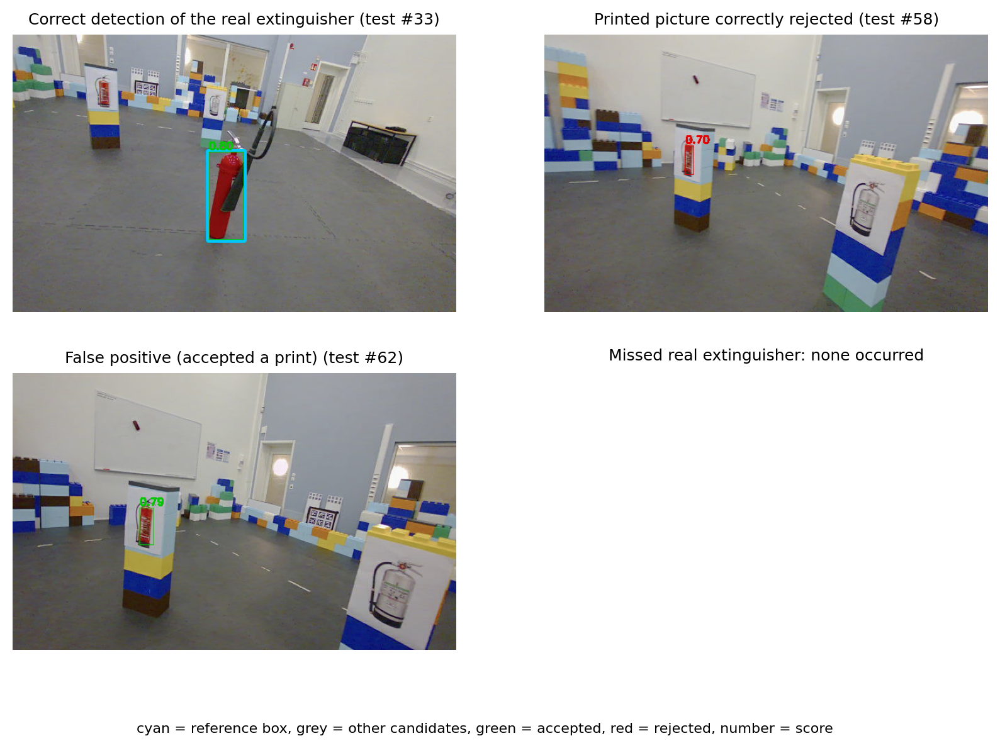

# Anchor-Based Object Recognition and Localization

**R7020E Computer Vision and Image Processing, Luleå University of Technology (group project)**

Given three anchor photos of one fire extinguisher, the system decides for every video frame whether that
extinguisher is present and draws a box around it, while rejecting printed pictures of extinguishers (decoys).
Everything runs on a CPU and nothing is trained.

HSV colour masks generate candidate regions, which are scored by three matchers: an HSV colour histogram
(baseline), SIFT, and a frozen DINOv2 ViT-S/14 embedding. Each matcher is tested with and without a depth-based
cue penalty that uses timestamp-paired depth frames to reject flat decoys. **Final system:** DINOv2 with the cue penalty.

## Results

Thresholds are tuned on `test` (development sequence) and applied unchanged to `eval` (held out).

| System | eval Precision / Recall | test Precision / Recall |
|---|---|---|
| HSV histogram (baseline) | 1.00 / 0.98 | 0.84 / 1.00 |
| HSV + cues | 1.00 / 0.96 | 0.92 / 1.00 |
| SIFT | 0.66 / 0.66 | 0.49 / 0.83 |
| SIFT + cues | 0.97 / 0.93 | 0.95 / 0.96 |
| DINOv2 | 1.00 / 0.99 | 0.88 / 0.96 |
| **DINOv2 + cues (final)** | **1.00 / 1.00** | **0.95 / 1.00** |

`eval` contains no frame without the target, so decoy rejection is only measured on `test`. Full results are in
[`results/results_table.csv`](results/results_table.csv) and figures in [`results/figures/`](results/figures).



Run every command below from this folder. Python 3.14.2 and the versions in `requirements.txt` were used.

## 1. Environment

Windows PowerShell (no activation or administrator privileges required):

```powershell
cd AnchorObjectRecognition
py -3.14 -m venv .venv
.venv/Scripts/python.exe -m pip install --upgrade pip
.venv/Scripts/python.exe -m pip install torch==2.10.0 torchvision==0.25.0 --index-url https://download.pytorch.org/whl/cpu
.venv/Scripts/python.exe -m pip install -r requirements.txt
.venv/Scripts/python.exe -m pip check
```

Linux/macOS: use `python3.14 -m venv .venv`, then replace
`.venv/Scripts/python.exe` with `.venv/bin/python` in all commands. Internet is
required to install dependencies and for the first DINOv2 model/source download.
The implementation uses CPU; CUDA is not required.

## 2. Reproduce the reported evaluation without raw data

The included `data/scores_test.csv`, `data/scores_eval.csv` and reference labels
allow evaluation without images or model weights:

```powershell
.venv/Scripts/python.exe src/evaluate.py
.venv/Scripts/python.exe src/verify_results.py
```

Expected output: `results/results_table.csv`, with seven systems for each of two
sequences (14 rows), and `PASS metric edge cases and all 14 saved result rows`.
For `6 DINOv2 + cues (final)`: test TP/FP/FN = 54/3/0; eval = 126/0/0.
The selected DINOv2 threshold is approximately 0.7601931691 and the cue penalty
is 0.05. `test` is the development sequence; `eval` is held out. Thresholds are
chosen on test and applied unchanged to eval. The center of the accepted box
must lie inside the reference box. Localization uses all accepted boxes in its
denominator. The eval sequence contains no target-absent frames.

## 3. Exact placement of original data for full recomputation

Raw recordings and full-size anchor photos are course inputs and are not included
in this repository. The included `anchors/` files are derived crops, not the original
photos required by the pipeline. Place the inputs beside the code directory:

```text
<parent-folder>/
  AnchorObjectRecognition/
    configs/default.yaml
    src/
    data/
    anchors/
  Project_3/
    raw/
      test/
        camera_color_image_raw/*.png
        camera_depth_image_raw/*.png
      eval/
        camera_color_image_raw/*.png
        camera_depth_image_raw/*.png
  Anchor_Images_extracted/
    Anchor_Images/
      Anchor1.png
      Anchor2.png
      Anchor3.png
```

Specifically, extract the course-supplied `raw.zip` **into `Project_3`**; the archive
already contains its `raw/` directory. Extract `Anchor_Images.zip` **into
`Anchor_Images_extracted`**; that archive already contains `Anchor_Images/`.
Do not add a second `raw/raw` or `Anchor_Images/Anchor_Images` level. Preserve
the original timestamped PNG filenames. The expected color frame counts are
93 in test and 126 in eval. RGB and depth PNG directories are needed; ROS bags
and camera-info text files are not read by this implementation.

`configs/default.yaml` resolves both input paths relative to
`AnchorObjectRecognition`, independently of the shell working directory:

```yaml
raw_dir: ../Project_3/raw
anchors_dir: ../Anchor_Images_extracted/Anchor_Images
```

Alternatively set these two YAML values to absolute paths (use forward slashes
for Windows paths). Keep test/eval and image subdirectories exactly as shown.

## 4. Recompute candidate scores and evaluation from images

Keep the supplied `data/labels_test.json` and `data/labels_eval.json` unchanged
to reproduce the reported reference annotations. Run in this order:

```powershell
.venv/Scripts/python.exe src/pipeline.py
.venv/Scripts/python.exe src/evaluate.py
.venv/Scripts/python.exe src/verify_results.py
.venv/Scripts/python.exe src/evaluate.py analysis
```

`pipeline.py` regenerates `anchors/anchor_crop_*.png` and overwrites
`data/scores_test.csv` and `data/scores_eval.csv`. Back up those two CSVs first
if you want to retain their original timing measurements. It scores every
candidate with all three matchers. The frozen DINOv2 ViT-S/14 source is pinned
to commit `7764ea0f912e53c92e82eb78a2a1631e92725fc8`; Torch Hub downloads
the source and pretrained weights on first use into its standard user cache.
Allow several minutes on CPU, plus first-download time. There is no training.
Timing fields vary by machine; recomputed scores may have small numerical
differences across software/platforms. `evaluate.py` writes the 14-row results
table, `verify_results.py` independently replays its metrics, and the optional
`analysis` command writes `results/analysis.json` (coverage, anchor subsets and
recall by size). Run evaluation before analysis.

## 5. Visualizations, tables and short demonstration videos

After evaluation and analysis, run from this code directory using the same
environment:

```powershell
.venv/Scripts/python.exe src/visualize.py
.venv/Scripts/python.exe src/make_tables.py
.venv/Scripts/python.exe src/make_demos.py
```

- `visualize.py` writes annotated detection examples, SIFT matches, score plots,
  candidate/anchor images and the architecture diagram to `results/figures/`.
  It also copies the figures to the generated `report/figures/` directory.
- `make_tables.py` writes numerical LaTeX tables to the generated `report/tables/`
  directory. Run `evaluate.py analysis` before this command.
- `make_demos.py` writes `results/demo_test.mp4` and `results/demo_eval.mp4`.
  These show the predicted boxes, scores and per-frame verdicts, with a five-second
  title card. At four frames per second their expected durations are 28.25 and
  36.5 seconds, respectively. All three scripts are the original project source.

The demo exporter additionally requires **FFmpeg with the libx264 encoder**,
installed separately and available on PATH. Check it with `ffmpeg -version`.
If FFmpeg is installed elsewhere, supply the executable explicitly:

```powershell
.venv/Scripts/python.exe src/make_demos.py --ffmpeg 'C:/path/to/ffmpeg.exe'
```

Alternatively, `.venv/Scripts/python.exe src/visualize.py demo eval` writes an
intermediate `results/demo_eval_raw.mp4` using OpenCV, without FFmpeg or a title
card. Run evaluation first. Replace `eval` with `test` for the development
sequence. These commands reproduce the figures, tables and demos from the included
scores and reference labels plus the external raw images and anchor photos.

## 6. Optional annotation tool

```powershell
.venv/Scripts/python.exe src/label_tool.py
```

Open `http://localhost:8000` in a browser; stop the server with Ctrl+C. This
requires the raw color images. Saving an annotation edits `data/labels_*.json`
and changes the evaluation reference, so use a separate copy for experiments.
The optional command `.venv/Scripts/python.exe src/label_tool.py prelabel` regenerates initial proposals
in `data/prelabels_*.json`; it does not replace the final reference labels.

## Source files

- `src/pipeline.py`: input loading, crops, candidate generation, matchers and depth features.
- `src/evaluate.py`: cue fitting, decisions, development tuning, metrics and numerical analysis.
- `src/verify_results.py`: independent metric replay and metric edge cases.
- `src/visualize.py`: inspect candidates, matching examples, plots and annotated video.
- `src/make_tables.py`: reproduce the numerical LaTeX tables.
- `src/make_demos.py`: export the two short annotated H.264 demonstrations.
- `src/label_tool.py`, `src/label_tool.html`: annotation server and browser interface.
- `configs/default.yaml`, `requirements.txt`: configuration and pinned dependencies.
- `data/`: reference labels, initial proposals and saved candidate scores.
- `anchors/`: derived target crops used as implementation input assets.

Raw recordings, full-size anchor photos and model weights are not included.
