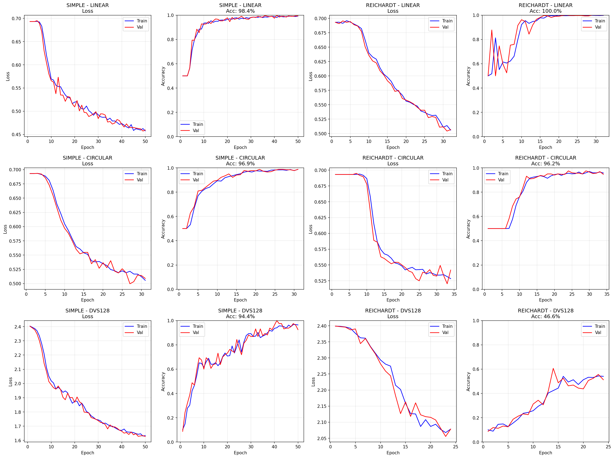

# Motion Detection with Spiking Neural Networks

**D7046E Neural Networks and Learning Machines, Luleå University of Technology (group project)**

Classifies the direction of motion in event-based (spiking) input using three spiking neural network (SNN) approaches. It compares a general-purpose network trained with surrogate gradients against a biologically inspired Reichardt motion detector and an STDP-based network.

## Models

| Model | Framework | Learning rule | Architecture |
|---|---|---|---|
| LIF (Simple) | snnTorch | Supervised, BPTT with surrogate gradients | Input (128×128) → 2 × 32 LIF hidden layers → output |
| Reichardt detector | snnTorch | Supervised, BPTT with surrogate gradients | 1,024 delay-and-correlate motion detectors → 64 hidden → output |
| STDP network | Brian2 | Unsupervised STDP features + trained readout | Spiking input → STDP hidden layer → softmax readout |

## Datasets

| Dataset | Classes | Description |
|---|---|---|
| Linear | 2 | Synthetic moving pattern, left vs right |
| Circular | 2 | Synthetic rotating pattern, clockwise vs counter-clockwise |
| DVS128 Gesture | 11 | Real recordings from a neuromorphic event camera |

The synthetic datasets are generated on the fly with configurable speed, noise and dropout (`common/config.yaml`).

## Results (test accuracy)

| Dataset | LIF (Simple) | Reichardt |
|---|---|---|
| Linear | 98.44% | **100.00%** |
| Circular | **96.88%** | 96.25% |
| DVS128 Gesture | **94.38%** | 46.56% |

The Reichardt detector matches or beats the general LIF network on the 2-class motion tasks it is designed for, but does not generalise to the 11-class gesture task. Figures and the compiled comparison are in [`results/`](results), including [`results/snn_results_compiled.ipynb`](results/snn_results_compiled.ipynb).



## Structure

```
SNNMotionDetection/
├── common/                 config.yaml (all parameters) and data utilities
├── data_generations/       synthetic event-data generator and DVS128 loader
├── part1_snnTorch/         LIF and Reichardt models, training, evaluation, main_pipeline.ipynb
├── part2_Brian2_STDP/      STDP training and continuous-sample evaluation
└── results/                figures, animations and compiled results notebook
```

## Running

```bash
pip install -r requirements.txt
jupyter notebook part1_snnTorch/main_pipeline.ipynb          # snnTorch models
python part2_Brian2_STDP/training_binary_continous_samples.py  # Brian2 STDP model
```

DVS128 Gesture is not included. It is loaded through [Tonic](https://tonic.readthedocs.io/) into the folder set by `dvs128_path` in `common/config.yaml`.
